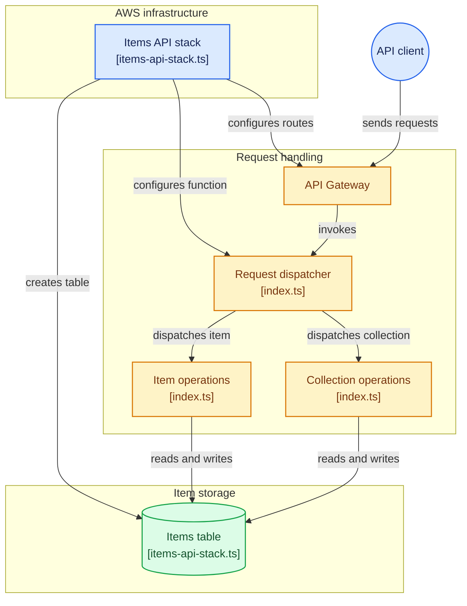

# Items CRUD API (AWS CDK)

A serverless REST API provisioned entirely with the AWS CDK (TypeScript). An API Gateway REST API routes requests to a single Node.js Lambda function, which reads and writes item records in a DynamoDB table. The Lambda handler is written in TypeScript too.

## Architecture Overview

This is a CDK application that provisions an items CRUD REST API backed by a DynamoDB table. The workflow is HTTP request → API Gateway route → Lambda handler → DynamoDB operation → HTTP response. The handler supports listing and creating items at `/items`, and reading, updating, and deleting items by ID. The CDK entry point creates a single stack that holds the table, the function, and the API.



Everything lives in one CDK stack:

| Stack | Defined in | Resources |
|-------|------------|-----------|
| `CrudApiStack` | `lib/crud-api-stack.ts` | DynamoDB table (partition key `id`, on-demand billing), Lambda function (`NodejsFunction`), REST API with five routes, `ApiEndpoint` and `TableName` outputs |

The table name is passed to the Lambda through the `TABLE_NAME` environment variable, and the Lambda is granted read/write access to the table through the CDK's `grantReadWriteData`.

## Tech stack

- **IaC:** AWS CDK v2 (TypeScript)
- **Compute:** AWS Lambda (Node.js 22.x), bundled with esbuild via `NodejsFunction`
- **API:** Amazon API Gateway REST API
- **Database:** Amazon DynamoDB (AWS SDK v3, `DynamoDBDocumentClient`)
- **Testing:** Jest (from the CDK scaffold) and a cURL smoke-test script

## Project structure

```
.
├── bin/
│   └── crud-api.ts            # CDK app entry point; instantiates the stack
├── lib/
│   └── crud-api-stack.ts      # Table + Lambda + REST API stack
├── lambda/
│   └── index.ts               # Lambda handler with all CRUD logic
├── test/
│   ├── crud-api.test.ts       # Jest test (placeholder)
│   └── items-api-test.sh      # cURL smoke tests against the deployed API
├── cdk.json
└── package.json
```

## Design decisions

| Decision | Why |
|----------|-----|
| **Serverless architecture** (API Gateway + Lambda + DynamoDB) | No servers to patch or scale, and cost is near zero when idle. A good fit for a small, spiky CRUD workload. |
| **Single stack** | The project is small enough that one stack is easier to read and deploy. Splitting data and compute into separate stacks is a reasonable next step as it grows. |
| **Single Lambda handling all routes** | One function with internal routing on HTTP method and route keeps the code in one place and means one deployment artifact and one set of logs. Routes are still declared individually in API Gateway, so the function could be split later. |
| **`NodejsFunction` (esbuild bundling)** | TypeScript is bundled at synth time, so there's no separate build or packaging step for the Lambda. |
| **AWS SDK v3 is not bundled** | The Node.js Lambda runtime already includes SDK v3, so it's installed as a dev dependency for types and compilation only. This keeps the bundle small. |
| **DynamoDB on-demand billing** | No capacity planning, and no cost when the API isn't used. |
| **Partition key `id` as a server-generated UUID v4** | Gives even key distribution, makes `GetItem`, `UpdateItem`, and `DeleteItem` single-key lookups, and keeps clients from choosing their own IDs. |
| **AWS SDK v3 `DynamoDBDocumentClient`** | Works with plain JavaScript objects and avoids manual attribute-value marshalling. |
| **DynamoDB client created outside the handler** | Warm invocations reuse the client instead of rebuilding it on every request. |
| **Table name passed as an environment variable** | The handler isn't coupled to a hardcoded name. CDK resolves the generated name at deploy time. |
| **`grantReadWriteData` for IAM** | CDK generates a policy scoped to this one table, instead of a hand-written or wildcard policy. |
| **`ConditionExpression` on update** | Updating an unknown ID returns `404` instead of silently creating a new item. |
| **`LambdaIntegration` for every route** | CDK also generates the permission that lets API Gateway invoke the function, so there's no separate permission resource to maintain. |
| **`RemovalPolicy.DESTROY` on the table** | Makes `cdk destroy` clean up completely during development. Not suitable for production data. |
| **Open CORS header (`*`) in responses** | Lets any front end or test client call the API during development. It should be restricted before real use. |

## Prerequisites

- Node.js 20+ and npm
- An AWS account with credentials configured (`aws configure` or environment variables)
- The AWS CDK CLI (`npm install -g aws-cdk`, or use `npx cdk`)
- The target account/region [bootstrapped](https://docs.aws.amazon.com/cdk/v2/guide/bootstrapping.html) once:

  ```bash
  cdk bootstrap
  ```

## Getting started

```bash
# Clone and install
git clone <your-repo-url>
cd crud-api
npm install

# Preview what will be created
cdk synth
cdk diff

# Deploy the stack
cdk deploy
```

When deployment finishes, the API URL is printed as the `ApiEndpoint` output of `CrudApiStack`. Use it as the base URL for the requests below.

## API reference

Base URL: the `ApiEndpoint` stack output (for example `https://abc123xyz.execute-api.us-east-1.amazonaws.com/prod/`).

| Method | Path | Description | Success |
|--------|------|-------------|---------|
| `GET` | `/items` | List all items | `200` |
| `POST` | `/items` | Create an item | `201` |
| `GET` | `/items/{id}` | Get an item by ID | `200` |
| `PUT` | `/items/{id}` | Update an item's name and description | `200` |
| `DELETE` | `/items/{id}` | Delete an item | `200` |

### Item object

```json
{
  "id": "a1b2c3d4-e5f6-7890-abcd-ef1234567890",
  "name": "Buy oat milk",
  "description": "The fancy barista edition"
}
```

`id` (UUID v4) is generated by the server. If `name` or `description` is omitted from a request, it is stored as an empty string.

### Examples

**Create an item**

```bash
curl -X POST "$API_URL/items" \
  -H "Content-Type: application/json" \
  -d '{"name": "Buy oat milk", "description": "The fancy barista edition"}'
```

**List items**

```bash
curl "$API_URL/items"
```

**Get an item**

```bash
curl "$API_URL/items/<id>"
```

**Update an item**

```bash
curl -X PUT "$API_URL/items/<id>" \
  -H "Content-Type: application/json" \
  -d '{"name": "Buy oat milk", "description": "Done!"}'
```

**Delete an item**

```bash
curl -X DELETE "$API_URL/items/<id>"
```

A ready-made smoke test is available in [`test/items-api-test.sh`](test/items-api-test.sh). It creates, lists, reads, updates, and deletes items, then exercises the error cases. Pass your API URL as the first argument:

```bash
chmod +x test/items-api-test.sh
./test/items-api-test.sh https://abc123xyz.execute-api.us-east-1.amazonaws.com/prod
```

### Error responses

| Status | Meaning |
|--------|---------|
| `400` | Unsupported route, or a request body that isn't valid JSON |
| `403` | Method or path with no API Gateway route (rejected before Lambda runs) |
| `404` | Item not found (`GET` or `PUT` on `/items/{id}`) |
| `500` | Unhandled server error (details are logged to CloudWatch) |

## Useful commands

| Command | Description |
|---------|-------------|
| `npm run build` | Type-check the project |
| `npm run watch` | Type-check on file changes |
| `npm run test` | Run the Jest unit tests |
| `cdk synth` | Emit the synthesized CloudFormation template |
| `cdk diff` | Compare the deployed stack with local changes |
| `cdk deploy` | Deploy the stack |
| `cdk destroy` | Tear down the stack |

## Cleanup

To avoid ongoing charges, remove the resources when you're done:

```bash
cdk destroy
```

The DynamoDB table uses `RemovalPolicy.DESTROY`, so **its data is deleted along with the stack**. The bootstrap resources stay in your account and are reused by future CDK projects.

## Known limitations and next steps

This project is a learning/demo build. Before using something like it in production, consider:

- **No authentication.** The API is public and responses allow all origins (`*`). Add an authorizer (for example Cognito or IAM) and restrict origins.
- **No schema validation.** Only malformed JSON is rejected (`400`). Missing or wrongly typed fields are accepted. Add schema validation (for example Zod).
- **`GET /items` uses a DynamoDB `Scan`**, which returns at most 1 MB per call, is not paginated, and gets expensive as the table grows.
- **`DELETE` doesn't check existence.** Deleting an unknown ID returns `200` instead of `404`.
- **Table removal policy is `DESTROY`.** Switch to `RETAIN` and enable point-in-time recovery for real data.
- **Tests are placeholders.** Add CDK assertion tests for the stack and unit tests for the handler.
- **Single Lambda for all routes.** Fine at this size; consider splitting per route as the API grows.
- **No monitoring.** Add CloudWatch alarms for Lambda errors and DynamoDB throttling.

## Author

**Emanuel Pruitt**: Software and Cloud Engineer
GitHub: [github.com/epruitt](https://github.com/epruitt)
LinkedIn:[linkedin.com/in/emanuelpruitt/](https://www.linkedin.com/in/emanuelpruitt/)